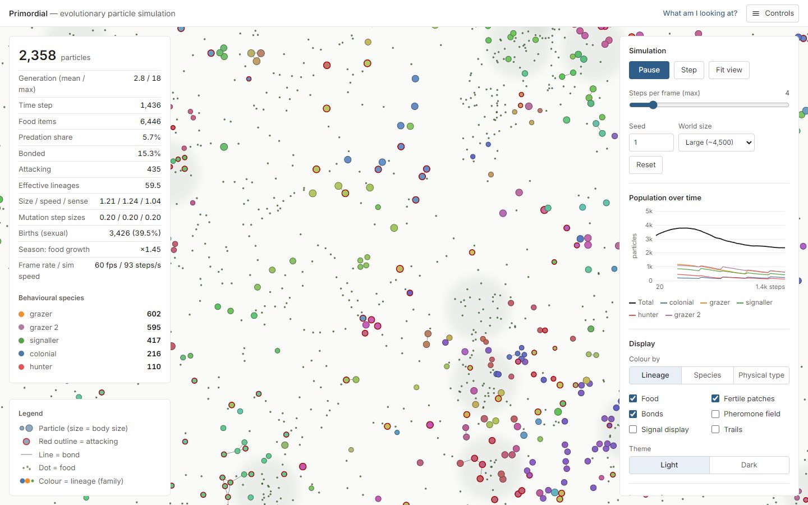
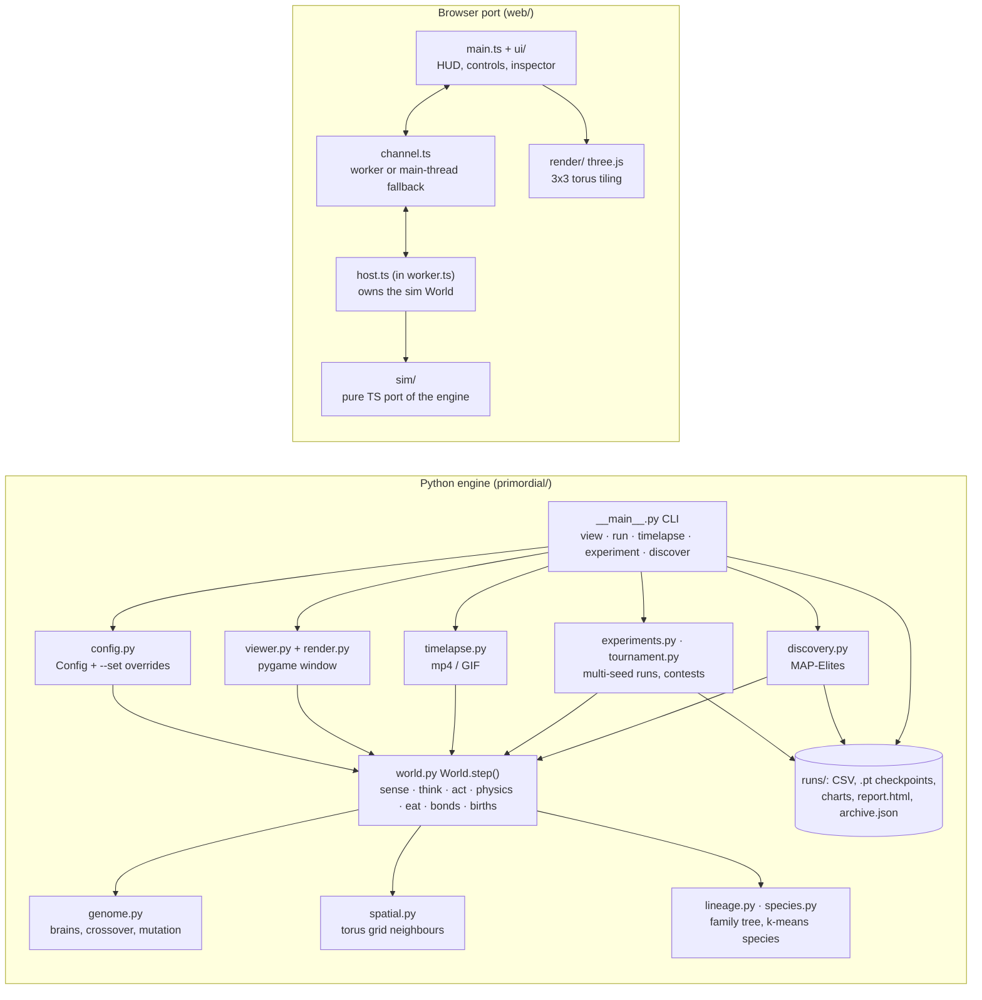

# primordial

**Artificial life that evolves by selection alone.** Particles with small neural-network brains and evolvable bodies forage, hunt, signal, bond into organisms, mate and die, with no fitness function and no training data.

[](https://github.com/LuisEduardoGE/primordial/actions/workflows/ci.yml)
[](LICENSE)




An artificial-life simulation in which particles with small neural-network brains and evolvable
bodies forage, hunt, signal, bond into multi-particle organisms, mate and die. There is no fitness
function and no training data. Behaviour comes from selection alone: particles that gather energy
reproduce, and their mutated offspring inherit what worked.

New to the idea? Read the plain-language guide in [`docs/explainer.html`](docs/explainer.html).

There are two implementations of the same ecosystem:

| | Python / PyTorch (`primordial/`) | Browser / TypeScript + three.js (`web/`) |
|---|---|---|
| Purpose | research: experiments, discovery, recording | sharing and large-scale viewing |
| Scale | ~300 particles at ~35 steps/s, ~1,600 at ~20 steps/s | ~2,500–4,500 particles |
| Extras | family tree, brain visualiser, timelapse, experiment reports | runs anywhere, single HTML file |

## Table of Contents

- [Features](#features)
- [Tech Stack](#tech-stack)
- [Architecture](#architecture)
- [Quick Start](#quick-start)
- [Usage](#usage)
- [Testing](#testing)
- [Project Structure](#project-structure)
- [The model](#the-model)
- [Results so far](#results-so-far)
- [Performance notes](#performance-notes)
- [Author](#author)
- [License](#license)

## Features

- **Open-ended evolution:** no fitness function. Particles that gather energy split or mate; children inherit mutated genomes (brain weights, particle-life attractions, body genes, learning rate, kinship colour).
- **Neural brains, batched:** every particle runs a recurrent MLP (25 → 16 → 9) with reward-modulated Hebbian plasticity; all brains run as one `einsum`.
- **Rich ecology:** foraging in wandering fertile patches, size-gated predation, signalling, two pheromone channels, bonding into multi-particle organisms, budding, seasons.
- **Interactive viewer (pygame):** inspect any particle and its live brain diagram, family tree, parameter sliders, god tools (drop food, meteor), video recording.
- **Research tools:** headless runs with CSV stats and checkpoints, timelapse video, multi-seed experiments with statistics and an HTML report, MAP-Elites world discovery, head-to-head tournaments.
- **Browser port:** the same ecosystem in TypeScript + three.js at ~12× the world area, built into one self-contained HTML file.

## Tech Stack

| Layer | Choice |
|---|---|
| Simulation engine | Python 3.10+, PyTorch 2.2+ (runs on CPU; `device` is a `Config` field) |
| Desktop viewer | pygame 2.5+ |
| Reports and video | matplotlib (charts), imageio + imageio-ffmpeg (mp4, GIF fallback via Pillow) |
| Browser port | TypeScript 5.9, three.js 0.180, Web Worker |
| Web build | Vite 7 + vite-plugin-singlefile |
| Tests | pytest (engine), Vitest (web) |
| Lint | ruff, `tsc --noEmit` |
| CI | GitHub Actions (CPU-only PyTorch) |

## Architecture



The PyTorch engine keeps every particle's state in fixed-capacity tensors, so one `World.step()`
updates the whole population with batched tensor operations. The CLI, viewer, timelapse,
experiments and discovery all drive the same `World`; experiments and discovery fan runs out to
worker processes and write CSVs, checkpoints and reports under `runs/`. The browser port re-implements
the engine in plain TypeScript, runs it in a Web Worker (or on the main thread if the worker is
starved), and streams typed-array frames to a three.js renderer. See [`web/README.md`](web/README.md)
for its fidelity notes and deliberate deviations.

## Quick Start

Prerequisites: Python 3.10+ and, for the browser version, Node.js 20.19+ (Vite 7).

```bash
python -m venv .venv
source .venv/bin/activate          # Windows: .venv/Scripts/activate
make install                       # CPU PyTorch, engine + dev/report extras, web packages
make view                          # interactive viewer
make dev                           # browser version (Vite dev server)
```

For a CUDA build, override the index: `make install TORCH_INDEX=https://download.pytorch.org/whl/cu124`.

Without make:

```bash
pip install torch --index-url https://download.pytorch.org/whl/cpu   # or a CUDA build
pip install -e ".[dev]" matplotlib imageio imageio-ffmpeg
python -m primordial view
cd web && npm install && npm run dev
```

Run `make` (or `make help`) to list all targets: `install`, `run`, `view`, `dev`, `test`, `lint`, `build`, `clean`.

## Usage

```bash
python -m primordial view                                  # interactive viewer
python -m primordial run --steps 20000 --log stats.csv --save run.pt
python -m primordial timelapse --load run.pt --steps 5000 --out evolution.mp4
python -m primordial experiment experiments/mutation.json --workers 8
python -m primordial discover --evals 24 --workers 6
python scripts/compete.py run.pt [other.pt]                # head-to-head contest
python scripts/bench.py                                    # steps/second benchmark
```

`make run` is a quick headless run (`STEPS=2000` by default) that prints population stats.

Any value in `primordial/config.py` can be overridden: `--set attack_rate=0.06 food_patches=8`.

Browser version: `make dev`, or `make build` for a single self-contained `web/dist/index.html`.
URL parameters and more are in [`web/README.md`](web/README.md).

### Viewer (`python -m primordial view`)

Click a particle to inspect its body, diet, evolved mutation sizes and a live diagram of its neural
network. Key bindings: SPACE pause · UP/DOWN speed · 1/2/3 inspect/add food/meteor tool ·
`[` `]` climate · C colour mode (lineage/type/species) · T trails · O pheromones · B bonds ·
P patches · F family tree · G parameter sliders · R record video · S save · H hide HUD · Q quit.

## Testing

```bash
make test      # pytest -q (engine) + vitest run (web)
make lint      # ruff check . + tsc --noEmit
```

65 tests pass: 55 pytest tests and 10 Vitest tests.

- **Engine (pytest):** world invariants (torus wrapping, determinism per seed, checkpoint round-trip, population floor), mechanics (grid neighbours vs brute force, size-gated predation, bonds, budding, mating and crossover, plasticity bounds, pheromones, meteor, lineage, species), mutation schemes, the pygame renderer and viewer (headless via `SDL_VIDEODRIVER=dummy`), timelapse output, and the experiment, tournament and discovery pipelines.
- **Web (Vitest):** grid neighbours vs brute force, brain forward pass and fast `tanh`, crossover, the particle-life kernel, and energy bookkeeping.

CI runs `make install`, `make lint`, `make test` and `make build` on every push and pull request
to `master`, with CPU-only PyTorch. No test needs a GPU.

## Project Structure

```
primordial/   engine: config, genome, world, spatial, lineage, species
              visuals: render, viewer, timelapse
              research tools: experiments, discovery, tournament
web/          TypeScript + three.js port (sim in a worker, single-file build)
docs/         plain-language explainer and screenshot
experiments/  experiment specs (JSON)
scripts/      compete (head-to-head), bench (steps/second)
tests/        pytest suite
Makefile      install / run / view / dev / test / lint / build / clean
```

## The model

Each simulation step (`World.step` in `primordial/world.py`):

1. **Sense**: 23 readings plus 2 memory values. They cover the nearest food, the direction of kin and of strangers, crowding, own energy and velocity, neighbours' signals, two pheromone gradients, bonds in use, the relative size of nearby strangers, and the season.
2. **Think**: a recurrent MLP (25 → 16 → 9), whose output layer carries reward-modulated Hebbian weights learned within each lifetime. All brains run as one batched `einsum`.
3. **Act**: thrust, aggression, signal, two pheromone deposits, bond intent, and 2 memory outputs.
4. **Physics**: particle-life attraction by physical type, plus bond springs, plus thrust divided by body size, with friction, on a torus.
5. **Metabolism**: base cost proportional to size^0.75, upkeep for speed and senses, and costs for movement, attack, signalling, scent and each bond.
6. **Predation**: aggressive particles drain non-kin they touch, but only victims no bigger than 1/0.8 of their own size.
7. **Eating**: food goes to the closest particle in reach. Food regrows mostly in wandering fertile patches, at a rate that follows a seasonal cycle.
8. **Learning**: plastic weights update from reward, which is the change in energy relative to the particle's own running baseline.
9. **Bonds**: kin form a bond when both want to and they are touching. Bonds break when strained or no longer wanted. Bonded particles share energy.
10. **Death and birth**: corpses become food. A particle above its energy threshold splits. If a compatible mate is near, the child gets neuron-wise crossover of both parents' genomes, and some children stay bonded to the parent (budding).

The genome holds the brain weights, particle-life attractions, body genes (size, speed, sense), a budding probability, a learning rate, a kinship colour, and four self-adaptive mutation step sizes.

Mutation is plain fixed-step Gaussian noise by default. Three optional mechanisms can be switched on: self-adaptive step sizes (`sigma_tau=0.2`), per-layer rates (`perception_rate_mult=0.5 behaviour_rate_mult=1.5`), and whole-neuron resets (`neuron_reset_prob=0.05`). They were the default until the experiment below found no benefit.

Analysis runs alongside the simulation:
- Every particle has a lineage ID, so the family tree of the living population can be extracted (`lineage.py`).
- Particles are clustered by body and behaviour with k-means and named automatically (`species.py`: grazer, hunter, colonial, signaller, trail-layer, drifter, scout).

## Results so far

- **Evolved vs random brains:** evolved populations drove random-brained ones extinct in 5/5 contests. This was with the earlier engine.
- **Self-adaptive mutation vs fixed mutation** (`experiments/mutation.json`): 8 seeds per variant, 6,000 steps, then head-to-head contests. The new scheme is not shown to be better. No end-of-run metric differs after Holm correction. In contests, fixed mutation won the majority in 6 of 8 seeds (per-seed sign test p = 0.29). The physics step size is the one sigma that consistently evolves upward (0.20 → 0.29).
- **World discovery** (MAP-Elites, 24 evaluations): found 9 elite worlds. The most interesting combine abundant food, strong short-period seasons, a high kin threshold and strong energy sharing along bonds. The archive (`runs/discovery/archive.json`) holds a `--set` command line to reproduce each one.

## Performance notes

- Neighbour search uses a uniform grid on the torus, built with tensor operations only. The candidate lists are then compacted to the largest number of in-range neighbours, which matters because populations clump.
- x and y coordinates are kept as separate arrays in the hot path. Broadcasting over a trailing dimension of size 2 was about 15× slower on CPU.
- In multi-process runs, use one torch thread per worker.

## Author

**Luis Eduardo G. Espindola** · [GitHub](https://github.com/LuisEduardoGE) · [LinkedIn](https://www.linkedin.com/in/luisgespindola/)

## License

[MIT](LICENSE) © Luis Eduardo G. Espindola
